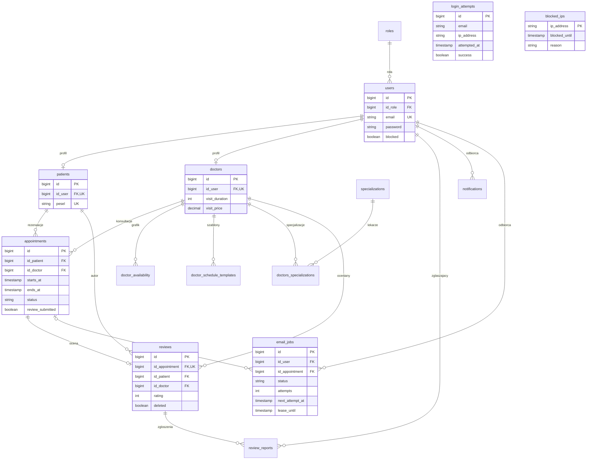

# Model danych

Encji JPA jest 14. `doctors_specializations` to tabela relacji wiele-do-wielu. `login_attempts` i `blocked_ips` są niezależnymi rejestrami technicznymi. `notifications.related_id` wskazuje kontekst powiadomienia, nie jest kluczem obcym. `flyway_schema_history` przechowuje wersje migracji i nie należy do modelu biznesowego.

`appointments.starts_at` i `ends_at` zapisują rzeczywisty przedział rezerwacji. Dwa ograniczenia `EXCLUDE USING gist` nie pozwalają na nachodzące nieanulowane wizyty tego samego lekarza ani pacjenta. Unikalne `reviews.id_appointment` ogranicza wizytę do jednej opinii. Przy usunięciu wizyty powiązanie `email_jobs.id_appointment` jest zerowane; usunięcie konta usuwa jego zadania pocztowe.
